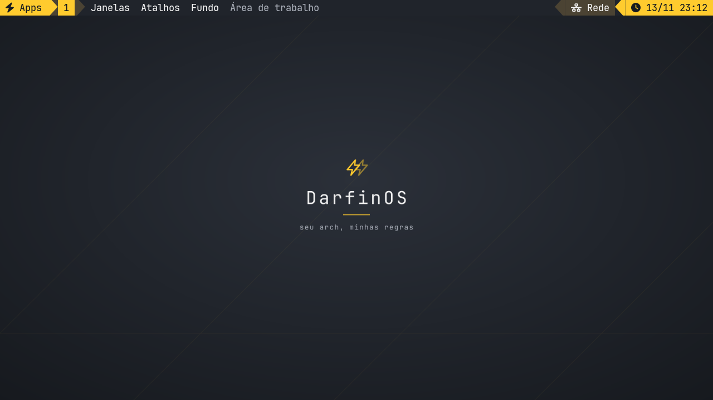

# After installation · Theme Workshop
[Português (Brasil)](pt-BR/CUSTOMIZATION.md)

Press **L** to install tools from Labs and **W** to open the Theme Workshop.
Presets choose packages. Appearance profiles control selected HOME files.
Each profile has a diff, per-file selection and a local undo history. Undo
keeps files edited after the run. **W** stays read-only with `--dry-run`.

```bash
bash DarfinOSInstallScript.sh --only lab_chezmoi,lab_matugen,lab_kvantum
python3 darfinos_control.py styles
python3 darfinos_control.py style sonicde-kvantum
python3 darfinos_control.py palette ~/wallpaper.png
python3 darfinos_control.py style-history
python3 darfinos_control.py style-undo RUN
```

- **Terminal**, **Compact i3** and **Workstation 1995** render local templates through chezmoi without importing your personal dotfile repository. For Window Maker, apply the profile and then select DarfinOS-1995 in its styles menu.
- **SonicDE + Kvantum** derives DarfinOSGold from the installed KvDark SVG theme. The profile sets only the relevant Qt style and theme settings. Apply all four listed files together, then reopen Qt apps or log back in. If the session overrides the setting, choose Kvantum in Application Style and DarfinOSGold in Kvantum Manager. It does not style the panel, change KWin or edit your login manager.
- **Xfce**. With Chicago95 and the desktop utilities installed, use **W → X** in an Xfce session. The action only sets the theme, icons, cursor and Xfwm style. This live Xfconf action is separate from the file-profile undo history.
- **autorandr**. Save a working layout with `autorandr --save notebook-720p` and try `autorandr --change`. Only save 30 Hz after verifying that it already works on the panel.
- **Maintenance**. `python3 darfinos_control.py maintenance --json` shows pending pacman config files using `pacdiff --output`. Opt in with `maintenance-timer enable` from a permanent checkout. The weekly user timer notifies only, never upgrades. Disable with `maintenance-timer disable`.
- **Backups**. etckeeper optionally initializes local /etc history. rustic is installed without setting up credentials, destinations or backup schedules. Neither is an OS snapshot.

For new Labs stages and original links, see [DarfinOS Labs](LABS.md). Arcan/Pipeworld and desktop sessions still need graphical validation in a disposable VM.

## i3 Notebook (720p)



**i3 Notebook** is separate from Compact i3. Install **i3 Notebook** in Labs
(**L**), then open **W → i3-notebook**, review the preview and apply it. The
Workshop keeps your previous i3 configuration in its undo history and leaves
global Polybar, Rofi and Dunst configs alone. Log out and back into i3 to load the
profile's session tools. XLibre is not required if X11 already works.

```bash
bash DarfinOSInstallScript.sh --only lab_i3_notebook
python3 darfinos_control.py style i3-notebook
python3 darfinos_control.py style i3-notebook --apply --all-files
```

| Shortcut | Action |
| --- | --- |
| Super+D / Super+Tab | Launch apps and switch windows in Rofi. dmenu is the app-launch fallback. |
| Super+F1 | Open the shortcut list, also available as the **Atalhos do i3** tab in Rofi. |
| Super+F2 | Inspect each output’s current resolution and refresh rate. If the built-in panel advertises 1280×720, test it at a 1:1 pixel scale and confirm within 15 seconds to keep it. Rejecting or timing out restores the previous mode, refresh rate and transform. |
| Super+Shift+P | Choose a wallpaper that is reapplied at login, or restore the DarfinOS default. Also available through **Fundo** on the bar. |
| Super+Enter / Super+B / Super+E | Open the terminal, the default browser, or your home folder in graphite-and-gold Thunar. The folder icon also opens Thunar. |
| Super+Shift+B | Show or hide the bar to free up screen space. |
| Super+1–9 / Super+0 | Switch to workspaces 1–10. Add Shift to move the current window. |
| Alt+Tab / Alt+Shift+Tab | Cycle through recent windows, including minimized ones. Release Alt to select or press Esc to cancel. |
| Super+Q | Close the focused window. |
| Super+Shift+Space | Toggle floating or tiling. |
| Super+M / Super+Shift+M | Minimize the focused window or restore the most recently minimized window to the current workspace. |
| Super+Ctrl+M / Super+F | Maximize without hiding the bar, or toggle fullscreen. |
| Super+F7 | Open graphical i3 Notebook preferences. |
| Super+Ctrl+Tab | Return to the previous workspace. |
| Super+H / Super+V / Super+Ctrl+E | Split horizontally or vertically, or toggle the current split direction. |
| Super+W / Super+S | Switch to tabbed or stacked layout. |
| Super+Shift+Enter or Super+Grave / Super+R | Pocket terminal and arrow-key resizing (Esc to exit). |
| Brightness and audio keys | Adjust brightness, volume and mute using your existing PipeWire or PulseAudio setup. |
| Print / Super+Shift+S / Shift+Print | The first two select a region. Shift+Print copies the entire screen. |
| Super+L | Lock the screen. xss-lock also locks before suspend. |
| Super+N / Super+Shift+N / Super+Ctrl+N | Redisplay the last notification, toggle Do Not Disturb, and dismiss visible pop-ups. |

The 28 px top bar uses JetBrainsMono Nerd Font Mono and keeps the workspace
switcher, launchers and a shortened window title on the left. On the right,
the tray and status controls fit the 720p layout.

#### Application themes

- **GTK 2, 3 and 4** have toolkit-specific graphite-and-gold styles. The
  Notebook session selects them via XSETTINGS and the profile's shortcuts,
  launcher and terminal. Legacy GTK 2 apps still require an existing GTK 2 runtime.
- **Qt 5 and 6** use Kvantum from Labs with the Workshop accent. Existing user
  Kvantum preferences are not overwritten and take priority. Select
  **DarfinOS-Notebook** in Kvantum Manager if you want the same theme in your
  other desktops, or try
  `sh ~/.config/darfinos/i3-notebook/session.sh qt-themed application` to
  launch just one app with a separate config.
- **Dolphin and KDE applications** also receive the Notebook color scheme for
  selections, focus and surfaces that Kvantum alone does not control.
  `sh ~/.config/darfinos/i3-notebook/session.sh dolphin` opens a fresh instance
  in i3 without overwriting the SonicDE theme.
- **Qt 4** has an optional legacy palette through
  `sh ~/.config/darfinos/i3-notebook/session.sh qt4 application`. This uses a
  separate config directory and does not install Qt 4.

GTK 1, Qt 1–3 and TQt do not receive the theme automatically. Apps with
their own appearance, libadwaita, Qt Quick and sandboxed apps may ignore
parts of the palette. No SonicDE or Trinity settings are edited. Restart open
applications to pick up the change.

The task dock next to the workspace buttons lists up to five windows from the
current workspace. Click an icon to focus the window. The active window is
underlined, `+N` opens the window picker, and the arrow counter opens
minimized windows from all workspaces. Right-click the keyboard icon to open
preferences.

Use **Super+F7** to adjust gaps, focus-follows-mouse and the default layout for
new workspaces. i3 validates the preferences before they are saved, and the
Workshop leaves the separate settings file alone on upgrades. The settings
window also launches ARandR for monitors and LXAppearance for GTK themes.
LXAppearance edits the account's GTK settings, outside of the i3 profile.

| Control | Action |
| --- | --- |
| Output / microphone or Super+F3 | Open the audio popup with independent live sliders and mute buttons. Right-click each icon to toggle its mute. Scroll over output to change volume. The mixer button opens per-app audio and device selection. |
| Wi-Fi / network | Open the Wi-Fi toggle and connection shortcuts. The tray applet lists nearby networks and supports joining them. Right-click the bar's network module to edit saved connections. |
| Bluetooth | Open controls even if BlueZ is stopped. Start the service, check adapter availability, toggle Bluetooth, or open Blueman to pair devices. |
| Dock player | Previous, play/pause and next. Appears when an MPRIS app starts playback, stays during pause, and hides when playback stops or the player closes. |
| Clock or Super+F5 | Open the monthly calendar, with month navigation and a Today button. |
| Power icon or Super+F6 | Open the session manager. Log out, restart, shut down and suspend are shown first and require confirmation in the popup. |
| Super+F4 | Open the DarfinOS Fastfetch preset, including its logo, in the Notebook terminal. |

**Super+Enter** and the pocket terminal use the same Nerd Font. The Workshop
installs the Notebook's Fastfetch preset with its logo. It also sets up plain
`fastfetch` in a new profile when there is no personal config or logo to
preserve. **Super+F4** always opens the DarfinOS preset. If Polybar cannot start,
native i3bar remains the fallback.

Wi-Fi controls require an active NetworkManager. Bluetooth requires an adapter
and BlueZ. The Labs step does not switch the system's network or audio service.
Use the separate Bluetooth step if you need to enable BlueZ.

The desktop pairs graphite surfaces with gold, bronze and sand status blocks.
The focused workspace has a solid accent background; inactive windows use subdued
borders. The centered launcher uses a separate search surface and roomier rows,
while the wallpaper adds a quiet diagonal pattern and DarfinOS wordmark.

The bar and Rofi design draw on [iamabhas’s dotfiles](https://github.com/iamabhas/dotfiles)
with DarfinOS colors and shortcuts. The Workshop accent applies to the bar,
Rofi, Dunst and the default wallpaper.

The Notebook Labs step installs [Bibata Modern Ice](https://github.com/ful1e5/Bibata_Cursor)
v2.0.7 from the official release with a pinned SHA-256 into
`${XDG_DATA_HOME:-~/.local/share}/icons`. Existing installations are preserved.
The profile reuses the SonicDE cursor theme and size if that theme is installed,
or uses an installed Bibata variant (24 px by default). It does not edit SonicDE
settings. Reloading the profile updates its own XSETTINGS cursor provider while
leaving providers started by other desktops alone.

The same cursor is passed to the bar and launched apps, including Notebook
pop-ups, without touching other desktop sessions. Pointer shapes for text or
resizing can still differ, but they come from the same cursor theme.

Right-click an empty area of the desktop to open a menu for apps, terminal,
files, wallpaper, display and i3 preferences. It stays on the clicked screen
and leaves right-clicks inside applications alone. Use the mouse wheel over the
volume or brightness indicator to adjust it in 5% steps. Click brightness for a
slider. The brightness control appears only when a screen backlight is available.

The 720p choice only changes the built-in panel and neither creates a mode nor
forces a refresh rate. If the panel does not advertise 1280×720, the menu explains
why the option is unavailable. A confirmed choice is reapplied at login with a
1:1 pixel scale; **Super+F2 → Parar de reaplicar 720p ao entrar** disables that
preference. External monitors keep their settings. With no image selected, the
profile uses a graphite wallpaper with the DarfinOS double lightning mark and
motto. **Fundo → Restaurar fundo DarfinOS** clears the custom image preference.
If a saved image is missing, the default wallpaper is used temporarily.
When upgrading, run the Notebook Labs step again for the new dependencies,
then reapply the Workshop profile.

Dunst shows up to three notifications in the top-right corner below the bar,
with Rofi's graphite palette and accent color. The profile does not stop a notification daemon already
running on the same D-Bus session. If needed, sign out of the other desktop
before testing in i3. Run `dunstify "DarfinOS" "Notifications ready"` in the i3
session to see the theme. Picom is neither installed nor started by this profile.

### Vivaldi across i3, SonicDE and Trinity

If Vivaldi shows a decryption warning, return to the desktop where the existing
profile opens normally. In the browser installer step
(`bash DarfinOSInstallScript.sh --only browser`), choose your edition and pin the
same password store. Do not select a different store just to dismiss the warning.
The installer changes launch options only. It does not touch browser profiles,
passwords, cookies or PAM. Close Vivaldi completely and reopen it from the menu
to apply the change. The wallet may still require its password to unlock.

For Arch's native package the option goes in `vivaldi-stable.conf`. For Flatpak
it is added to the user launcher shared by desktops. When running
`flatpak run com.vivaldi.Vivaldi` manually, pass the same
`--password-store=...` option yourself.
