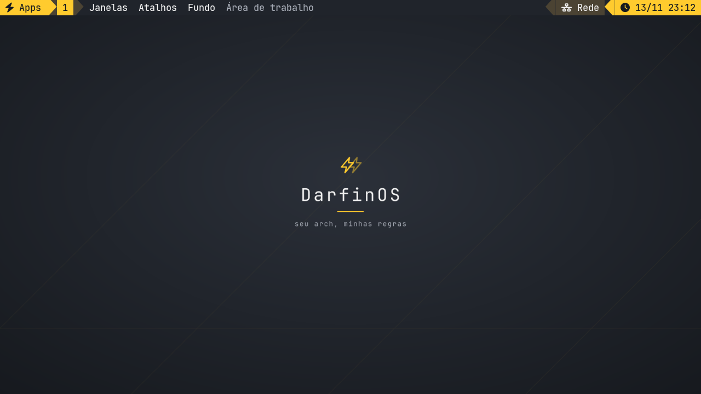

# Depois da instalação · Oficina de Temas
[English](../CUSTOMIZATION.md)

Na TUI, **L** instala as ferramentas do Labs e **W** abre a Oficina.
Presets escolhem pacotes. Perfis de personalização mudam arquivos escolhidos
no HOME, com prévia, aplicação seletiva e histórico para desfazer. O desfazer
preserva arquivos editados após a aplicação. Em `--dry-run`, **W** só consulta.

```bash
bash DarfinOSInstallScript.sh --only lab_chezmoi,lab_matugen,lab_kvantum
python3 darfinos_control.py styles
python3 darfinos_control.py style sonicde-kvantum
python3 darfinos_control.py palette ~/wallpaper.png
python3 darfinos_control.py style-history
python3 darfinos_control.py style-undo IDENTIFICADOR
```

- **Terminal**, **i3 Compacto** e **Workstation 1995** usam templates locais do chezmoi sem importar seu repositório pessoal. No Window Maker, aplique o perfil e depois selecione DarfinOS-1995 no menu de estilos.
- **SonicDE + Kvantum** cria DarfinOSGold com base no tema SVG KvDark. Aplique os quatro arquivos juntos e reabra os aplicativos Qt ou a sessão. Se a sessão sobrescrever a preferência, selecione Kvantum em Estilo dos aplicativos e DarfinOSGold no Kvantum Manager. Painel, KWin e tela de login ficam como estão.
- **Xfce**. Com Chicago95 e os utilitários de desktop instalados, use **W → X** dentro do Xfce. Só muda tema, ícones, cursor e estilo do Xfwm. Esse ajuste ao vivo via Xfconf fica fora do histórico de arquivos dos perfis.
- **autorandr**. Depois de ajustar a tela, salve com `autorandr --save notebook-720p` e teste `autorandr --change`. Só grave 30 Hz se esse modo já funcionar no painel.
- **Manutenção**. `python3 darfinos_control.py maintenance --json` lista pendências com `pacdiff --output`. De uma cópia permanente, rode `python3 darfinos_control.py maintenance-timer enable` para receber avisos semanais, sem atualizar nada. Para desligar, use `maintenance-timer disable`.
- **Backups**. O etckeeper oferece histórico local do /etc. O rustic não cria destino, senha ou agendamento sozinho. Nenhum dos dois substitui um snapshot do sistema.

Veja as novas etapas e os links originais no [DarfinOS Labs](LABS.md). Arcan/Pipeworld e as sessões gráficas ainda precisam de validação em VM.

## i3 Notebook (720p)



O perfil **i3 Notebook** é separado do i3 Compacto. Instale **i3 Notebook** pelo
Labs (**L**), abra **W → i3-notebook**, revise a prévia e aplique. Ele guarda a
configuração anterior do i3 no histórico da Oficina e não sobrescreve suas
configurações globais de Polybar, Rofi ou Dunst. Encerre e entre novamente na sessão i3
para carregar os utilitários do perfil. Não precisa instalar XLibre se já tem
um servidor X11 funcionando.

```bash
bash DarfinOSInstallScript.sh --only lab_i3_notebook
python3 darfinos_control.py style i3-notebook
python3 darfinos_control.py style i3-notebook --apply --all-files
```

| Atalho | Ação |
| --- | --- |
| Super+D / Super+Tab | Apps e janelas no Rofi. dmenu fica de reserva para apps. |
| Super+F1 | Lista de atalhos, disponível também como aba **Atalhos do i3** no Rofi. |
| Super+F2 | Mostra a resolução e os Hz atuais por saída. Se a tela interna oferecer 1280×720, dá para testar o modo sem escala. Sem confirmar em 15 s, restaura modo, Hz e transformação anteriores. |
| Super+Shift+P | Escolhe uma imagem e reaplica ao entrar no i3, ou restaura o fundo DarfinOS. Também disponível em **Fundo**, na barra. |
| Super+Enter / Super+B / Super+E | Abre o terminal, o navegador padrão ou o Thunar grafite e dourado. O ícone de pasta da barra também abre o Thunar. |
| Super+Shift+B | Mostra ou oculta a barra para liberar espaço na tela. |
| Super+1–9 / Super+0 | Vai para as áreas 1–10. Com Shift, move a janela atual. |
| Alt+Tab / Alt+Shift+Tab | Percorre as janelas recentes, inclusive as minimizadas. Solte Alt para trocar ou tecle Esc para cancelar. |
| Super+Q | Fecha a janela atual. |
| Super+Shift+Espaço | Alterna entre flutuante e lado a lado. |
| Super+M / Super+Shift+M | Minimiza a janela atual ou restaura a última minimizada na área atual. |
| Super+Ctrl+M / Super+F | Maximiza sem esconder a barra, ou alterna a tela cheia. |
| Super+F7 | Preferências gráficas do i3 Notebook. |
| Super+Ctrl+Tab | Volta à área anterior. |
| Super+H / Super+V / Super+Ctrl+E | Divide na horizontal ou vertical, ou alterna a direção da divisão atual. |
| Super+W / Super+S | Organiza as janelas em abas ou em pilha. |
| Super+Shift+Enter ou Super+Grave / Super+R | Terminal de bolso e redimensionamento com as setas (Esc para sair). |
| Teclas de brilho e áudio | Brilho, volume e mute. O perfil usa o PipeWire ou PulseAudio já configurado. |
| Print / Super+Shift+S / Shift+Print | Os dois primeiros selecionam uma área. Shift+Print copia a tela inteira. |
| Super+L | Bloqueia a tela. A sessão também usa xss-lock antes de suspender. |
| Super+N / Super+Shift+N / Super+Ctrl+N | Recuperar a última notificação, ativar ou desativar o Não Perturbe e dispensar os pop-ups. |

A barra de 28 px usa JetBrainsMono Nerd Font Mono. Áreas de trabalho, atalhos e
o título abreviado da janela ficam à esquerda. A bandeja e os indicadores
ficam à direita, mantendo o layout compacto para 720p.

#### Tema de aplicativos

- **GTK 2, 3 e 4** têm arquivos próprios do tema grafite/dourado. O i3 Notebook
  seleciona o tema via XSETTINGS e nos atalhos, Rofi e terminal do perfil. Apps
  GTK 2 precisam já ter o runtime antigo instalado.
- **Qt 5 e 6** usam o Kvantum instalado pelos Labs, com a mesma cor de destaque
  da Oficina. A configuração pessoal do Kvantum não é modificada e tem
  precedência se já existir. Nesse caso, selecione **DarfinOS-Notebook** no
  Kvantum Manager se quiser o mesmo tema também nos outros ambientes, ou use
  `sh ~/.config/darfinos/i3-notebook/session.sh qt-themed aplicativo` para testar
  só nesse app com configuração separada.
- **Dolphin e aplicativos KDE** recebem também o esquema de cores do
  Notebook. Isso corrige seleção, foco e superfícies que o Kvantum sozinho
  não controla. O lançador `sh ~/.config/darfinos/i3-notebook/session.sh dolphin`
  abre uma instância nova no i3, sem sobrescrever o tema do SonicDE.
- **Qt 4** tem uma paleta legada com o lançador opcional
  `sh ~/.config/darfinos/i3-notebook/session.sh qt4 aplicativo`. Ele usa uma
  configuração separada, portanto o app pode não ler suas preferências usuais.
  O perfil não instala Qt 4.

GTK 1, Qt 1–3 e TQt não recebem esse tema automaticamente. Apps com visual
próprio, libadwaita, Qt Quick ou em sandbox podem ignorar partes da paleta. O
perfil não muda configurações gerais do SonicDE ou Trinity. Reabra os apps
para ver o tema, inclusive se o Thunar já estava rodando antes da atualização.

A dock junto às áreas de trabalho mostra até cinco janelas da área atual.
Clique em um ícone para focar a janela. O sublinhado indica a janela ativa,
`+N` abre a lista de janelas e a seta com contador abre as minimizadas de
todas as áreas. Clique direito no teclado da barra para abrir as preferências.

Em **Super+F7**, ajuste os espaços, as margens, o foco por mouse e o layout
padrão de novas áreas. As preferências são validadas pelo i3 antes de salvar
e ficam num arquivo separado, preservado ao reaplicar a Oficina. O mesmo
painel abre o ARandR para monitores e o LXAppearance para temas GTK. O
LXAppearance usa as configurações GTK da conta, fora do perfil do i3.

| Controle | Ação |
| --- | --- |
| Saída / microfone ou Super+F3 | Abre o pop-up com sliders independentes e ajuste imediato. Clique direito em cada ícone alterna o mute. A roda sobre a saída ajusta o volume. O botão do mixer abre o volume por app e a seleção de dispositivos. |
| Wi-Fi / rede | Abre o controle para ligar ou desligar o Wi-Fi e os atalhos de conexão. O applet da bandeja lista redes próximas e permite conectar. O clique direito no indicador abre o editor de conexões salvas. |
| Bluetooth | Abre o pop-up mesmo com o serviço parado. Mostra se falta adaptador, permite iniciar o BlueZ ou ligar/desligar o rádio e abre o Blueman para parear. |
| Player na dock | Anterior, reproduzir/pausar e próximo. Aparece ao começar a tocar em um app compatível com MPRIS, continua durante a pausa e some ao parar ou fechar o player. |
| Relógio ou Super+F5 | Abre o calendário mensal, com navegação por mês e botão Hoje. |
| Ícone de energia ou Super+F6 | Abre o gerenciador de sessão. Encerrar, reiniciar, desligar e suspender ficam no topo e pedem confirmação no próprio painel. |
| Super+F4 | Abre o Fastfetch do DarfinOS com o logo, no terminal Notebook. |

**Super+Enter** e o terminal de bolso usam a mesma Nerd Font. A Oficina instala
o tema e o logo do Fastfetch do Notebook. Também prepara o comando `fastfetch`
normal se não houver configuração ou logo pessoal. **Super+F4** sempre abre
o tema do DarfinOS. Se a Polybar falhar ao iniciar, a barra nativa do i3 é
usada como reserva.

O Wi-Fi usa um NetworkManager ativo. O Bluetooth precisa de adaptador e
BlueZ. Os Labs não trocam o gerenciador de rede nem o servidor de áudio.
Para ativar o BlueZ, use a etapa Bluetooth separada do DarfinOS.

O desktop combina superfícies grafite com blocos de status dourados, bronze e
areia. A área de trabalho focada recebe um fundo na cor de destaque; janelas
inativas usam bordas discretas. O launcher centralizado tem busca em uma
superfície própria e linhas mais espaçosas. O fundo traz diagonais sutis, a
marca DarfinOS e o lema do sistema.

O visual da barra e do Rofi foi inspirado nos [dotfiles do iamabhas](https://github.com/iamabhas/dotfiles),
com as cores e os atalhos do DarfinOS. A cor de destaque escolhida na Oficina
é aplicada na barra, no Rofi, no Dunst e no papel de parede padrão.

A etapa Notebook dos Labs instala o [Bibata Modern Ice](https://github.com/ful1e5/Bibata_Cursor)
v2.0.7 da release oficial, com SHA-256 fixo, em
`${XDG_DATA_HOME:-~/.local/share}/icons`. Instalações existentes são preservadas.
O perfil reaproveita o tema e o tamanho do cursor configurados no SonicDE, quando
o tema está instalado. Se não achar o tema escolhido, usa uma variante Bibata
instalada (24 px por padrão). A sessão i3 não altera os arquivos do SonicDE.
Recarregar o perfil atualiza o provedor XSETTINGS que ele próprio iniciou,
preservando provedores de outros ambientes.

A barra e os aplicativos abertos pelo perfil, incluindo os pop-ups, usam o
mesmo cursor sem alterar outras sessões. O ponteiro ainda pode mudar de forma
sobre texto ou bordas de redimensionamento, mas mantém o mesmo tema.

Clique com o botão direito em uma área vazia da área de trabalho para abrir
aplicativos, terminal, arquivos, papel de parede, tela ou preferências do i3.
O menu fica dentro do monitor clicado e não interfere no clique direito dos
aplicativos. Use a rodinha sobre os indicadores de volume e brilho para ajustar
em passos de 5%. Clique no brilho para abrir o controle deslizante. O controle
só aparece quando o sistema encontra uma iluminação de tela compatível.

A opção de 720p só mexe na tela interna, não inventa modos nem força taxa de
atualização. Se o painel não oferecer 1280×720, o menu explica a indisponibilidade.
A escolha confirmada é reaplicada ao entrar com escala 1:1; **Super+F2 → Parar de
reaplicar 720p ao entrar** desativa essa preferência. Monitores externos mantêm
suas configurações. Sem imagem selecionada, o perfil usa o fundo grafite com o
duplo raio e o lema do DarfinOS. **Fundo → Restaurar fundo DarfinOS** remove a
preferência de imagem personalizada. Se uma imagem salva sumir, o fundo padrão
é usado temporariamente. Se estiver atualizando o perfil, rode o Labs novamente
para instalar as novas dependências antes de reaplicar pela Oficina.

O Dunst exibe até três notificações no canto superior direito, abaixo da barra,
com fundo grafite e a cor de destaque do Rofi.
Se outro daemon de notificações já estiver ativo no mesmo barramento D-Bus, o
perfil não o encerra. Nesse caso, saia do outro ambiente e entre na sessão i3
para testar. Dentro do i3, rode `dunstify "DarfinOS" "Notificações prontas"` para
ver o tema. A personalização não instala nem inicia o Picom.

### Vivaldi entre i3, SonicDE e Trinity

Se o Vivaldi exibir **Falha de descriptografia / risco de perda de dados**, volte
ao ambiente onde o perfil abre normalmente. Na etapa **Vivaldi e chaveiro entre
ambientes** do instalador, escolha a edição que você usa e fixe o **mesmo**
chaveiro que já abre esse perfil. KWallet 6 é uma opção em instalações
SonicDE/Plasma 6. GNOME/Secret Service e KWallet 5 são alternativas apenas se
já forem o chaveiro do seu perfil. Não adivinhe nem aceite perder dados para
testar. O instalador não toca em senhas, cookies, perfis ou PAM.

A etapa também pode ser executada com
`bash DarfinOSInstallScript.sh --only browser`. Feche todas as janelas e processos
do Vivaldi antes de reabrir pelo menu. No Flatpak, o atalho da conta vale em
todos os ambientes e mantém a mesma ID para os links. Se você executar
`flatpak run com.vivaldi.Vivaldi` manualmente, inclua a mesma opção
`--password-store=...`. No pacote nativo do Arch, ela fica em
`vivaldi-stable.conf`. O chaveiro ainda pode pedir a senha para ser desbloqueado.
